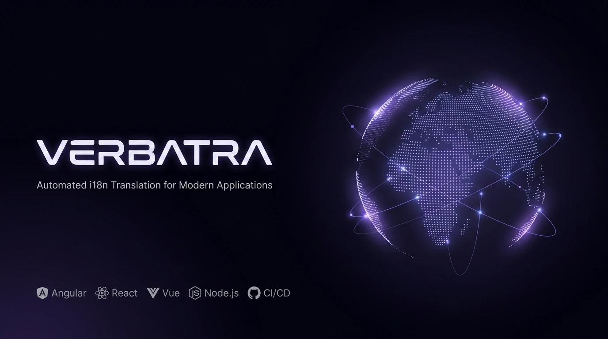

  

<h1 align="center">verbatra</h1>

  Open source i18n automation: translate only what changed, gate CI on drift, keep placeholders intact. CLI, SDK, Studio, MCP server and GitHub Action.

  <a href="https://verbatra.kreitz-webdev.de/docs">Documentation</a> ·
  <a href="https://verbatra.kreitz-webdev.de/docs/quickstart">Quickstart</a> ·
  <a href="https://github.com/marketplace/actions/verbatra">GitHub Action</a>

  <a href="https://github.com/verbatra/verbatra">verbatra/verbatra</a>: the CLI, SDK, Studio and MCP server 
  <a href="https://github.com/verbatra/action">verbatra/action</a>: the GitHub Action 
  <a href="https://github.com/verbatra/skills">verbatra/skills</a>: agent skills

